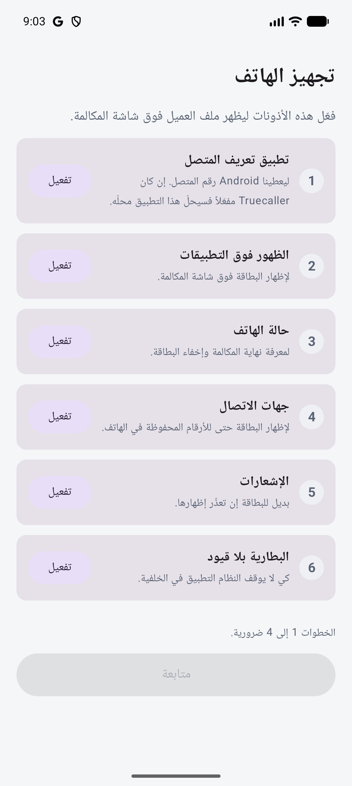
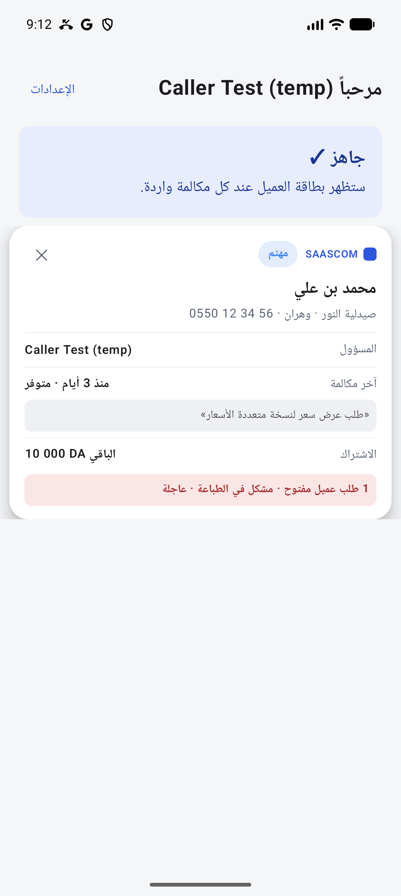

# SAASCOM Caller (Android)

When a client calls a sales or SAV agent, this app shows the client's CRM card over the call screen.
It is linked to the CRM in `../soft_client_suivi` (Laravel) through `/api/mobile`.

- Plan and mockups: [`project-plan.html`](project-plan.html)
- Step-by-step phases and the API contract: [`phases/`](phases/README.md)

| Setup screen | Card (sample data, «تجربة البطاقة» button) |
|---|---|
|  |  |

> Screenshots must never show real client data (personal data, Algerian Law 18-07). Use the sample card.

## Build

Requirements: Android SDK (`local.properties` → `sdk.dir`), JDK 17. Gradle comes from the wrapper.

```bash
./gradlew :app:testDebugUnitTest   # unit tests (phone format table, API client, parsing…)
./gradlew :app:assembleDebug       # app/build/outputs/apk/debug/app-debug.apk
```

- **Debug** builds (`com.saascom.caller.debug`) talk to `http://10.0.2.2:8000` (the PC, seen from the emulator).
  The address can be changed on the login screen, e.g. `http://192.168.1.20:8000` for a real phone on the same Wi-Fi.
  Start the CRM with `php artisan serve --host=0.0.0.0 --port=8000`.
- **Release** builds use `saascom.crmUrl` from `gradle.properties` (HTTPS only) and sign with `keystore.properties`
  (git-ignored, see `phases/phase-1-android-mvp.md` 1.16).

## Try a call on the emulator

```bash
adb install -r app/build/outputs/apk/debug/app-debug.apk
# Log in, go through the setup screen, then:
adb emu gsm call 0550123456      # a number that exists in the CRM
adb emu gsm accept 0550123456    # answer: the card stays during the call
adb emu gsm cancel 0550123456    # hang up: the card disappears
adb logcat -s CallerCard         # debug timing: "local card shown in … ms"
```

Good to know:
- After **Force stop**, Android does not start the app for calls until it is opened once (Android's rule for stopped apps).
- `uiautomator dump` cannot see the card (it is an overlay window): check it with a screenshot.
- If port 8000 is taken on your PC, run the CRM on another port and change the address on the login screen.

## Code map

| Folder | What |
|---|---|
| `call/` | Runs while the phone rings and right after: `CallerScreeningService` (gets the number), `CallerCardController` (local list → card → CRM → after-call), `AfterCallPolicy` (what to offer when the call ends), `OverlayCard` (card / after-call bar over the screen), `CallStateWatcher` (answered / ended), `CallNotifier` (fallback, after-call and missed-call notifications) |
| `data/` | `ApiClient` + `Dto` + `LogCall` (the API contract), `LocalDb` + `Outbox` (call history, writes waiting for the network), `Session` (token encrypted with the Android Keystore), `DirectoryDb` (client list in SQLite), `DirectoryRepository` + `SyncWorker` (sync every 2 h with ETag), `SettingsStore` |
| `ui/` | Compose screens: login, setup (permissions), tabs «الأخيرة / بحث / الإعدادات», client page, after-call form, new lead, SAV request, in-app update; `components/CallerCard` is shared by the overlay and the app |
| `util/` | `PhoneNormalizer` (same rules as the CRM's `App\Support\Phone`), `Formats` (Algiers time, Arabic wording, DA), `Labels`, `Permissions` |
